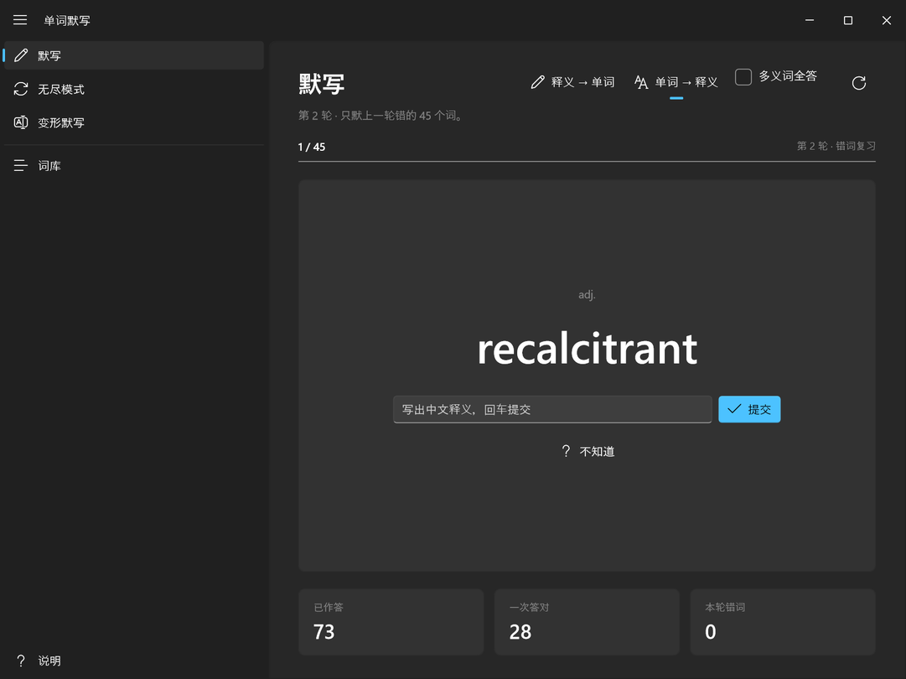
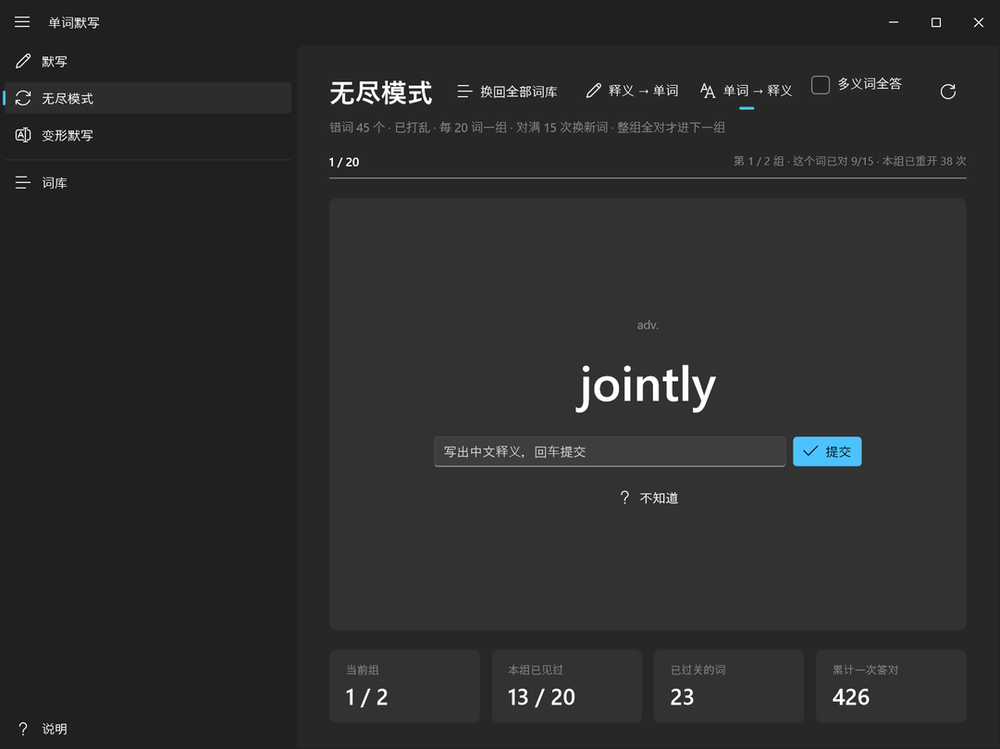
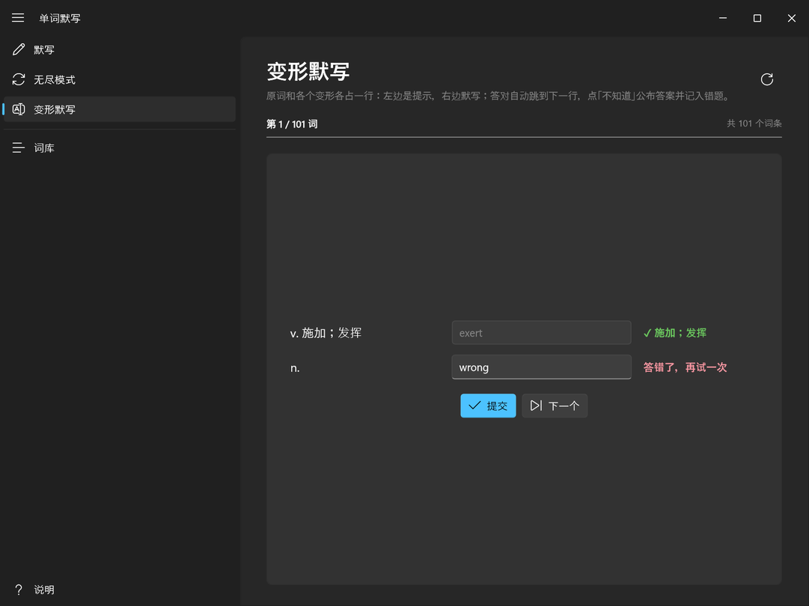

# xent-dictation · 单词默写

Windows 原生背词工具，Python 编写，界面用 [xenthon](https://github.com/Project-Xent/xenthon)（Project-Xent 的 Python 绑定，WinUI 风格控件）。

> 2.0 起整体用 Python 重写，原来的 C23 版本留在标签 [`c-final`](https://github.com/firnspiegel/xent-dictation/tree/c-final)。
> C 版的进度文件 dictation_progress.bin 首次启动时会自动转成 dictation_progress.json，原文件保留不动。



## 功能

- 两种题型：释义 → 单词（首字母提示）、单词 → 释义。
- 普通默写：错词进入下一轮，全部答对后完成。
- 无尽模式：每 20 个词一组；答错后显示答案，重开时将本组见过的词打乱排在前面，未见过的词保持原顺序。整组一次答对后进入下一组。
  一个词一次答对（没先提交答错）满 15 次就移出本组，从后面的词里按顺序补一个进来，本组保持 20 个；「不知道」不清零次数，从第 1 组重新开始才清零。
- 默写一轮结束的结果页可以「错词进无尽模式」：这一轮的错词打乱后替换无尽模式的进度（结果页不变，还能接着开下一轮），无尽页可「换回全部词库」。
- 变形默写（原来单独的 tkinter 小程序，现在合进来）：一屏一个词条，原词和各个变形（名词、形容词、副词……）各占一行，答对自动跳到下一行；一轮结束先看错题，错题轮重练直到全对。
- 导航栏切换默写、无尽模式、变形默写、词库和说明；几种练习各自保留进度，关掉再开接着做。
- 词库支持输入窗口和剪贴板批量导入，自动跳过重复词，清空需确认。
- 录入时自动去掉单词表上的标注（如「忘记 获利丰厚的」→「获利丰厚的」、「少词义 发展 …」），只删跟其他释义不沾边的，forget「忘记」这类不动。
- 一词多义里意思相同的释义自动合并（如「缓解、减轻」→「缓解（减轻）」，写哪个都算答对这一项）：录入新词时自动检查，已有词库在词库页点「合并同义释义」。
- 虚拟化词表列表，词再多也只构建看得见的几行。
- 可选本地模型判分，后台线程处理请求，不卡界面。

| 无尽模式 | 变形默写 |
|---|---|
|  |  |

## 源码结构

| 文件 | 职责 |
|---|---|
| dictation/app.py | 消息处理（update）、各页面视图（view）、入口 |
| dictation/session.py | 普通轮次与无尽模式状态机 |
| dictation/forms.py | 变形默写状态机 |
| dictation/words.py | 词库读写、批量导入 |
| dictation/text.py | 字面判分、一词多义、提示等文本工具 |
| dictation/judge.py | 本地模型判分（拉起 / 结束服务、三种后端） |
| dictation/progress.py | 进度存档，C 版 .bin 迁移 |
| dictation/forms_words.json | 自带的变形默写词条 |
| tests/ | 后端测试（从 C 版 test_dict_core.c 移植，外加变形默写和进度迁移） |

## 依赖

Windows 10/11、Python 3.12+、xenthon。

xenthon 目前要从源码编译（xmake，见 xenthon 的 README），需要 2026-11-20 之后的 main：
后台线程 `xtk.post()`、`focus=` 焦点令牌、NavigationView / SelectorBar 的 `items=` 条目都是这之后才合并进去的。
编好后 `src/xenthon` 下有 `_reconcile.pyd`。

还有一个没合并的小修复 [xenthon#4](https://github.com/Project-Xent/xenthon/pull/4)：不带它的话，用 `DICT_START_PAGE` 直接打开某一页时，左侧导航高亮会停在第一项（页面本身是对的）。

## 运行

数据文件默认在**当前目录**：

```bat
set PYTHONPATH=<xenthon>\src;<本仓库>
cd /d <数据目录>
pythonw -m dictation
```

也可以 `python -m dictation 词表.json 判分配置.json` 指定路径，其余数据文件放在词表同目录。
run-dictation.bat 是启动脚本示例，改一下其中两个路径后放到数据目录里双击。

## 数据

| 文件 | 内容 |
|---|---|
| dictation_extra.json | 词表，`[["word","pos","meaning"], ...]` |
| dictation_judge.json | 可选的本地判分配置 |
| dictation_settings.json | 「多义词全答」开关 |
| dictation_progress.json | 练习进度（程序自动写） |
| dictation_forms.json | 可选，自定义变形默写词条；没有就用自带的 |

`samples/` 里有示例，复制到数据目录并去掉 .sample 后使用。本地词库与判分配置不纳入版本控制。

变形默写词条格式：

```json
[{"meaning": "v. 施加；发挥", "forms": [["exert", "v.", "施加；发挥", ""], ["exertion", "n.", "努力；运用", ""]]}]
```

forms 每项是 单词（双拼写用 / 隔开，如 `fueled/fuelled`）、词性、该形式的释义、语义标注。

### 本地判分

判分器有三种（`api` 字段），推荐 `systemone` + vllm-d3-nano：
- 不写：0.8B（Jev-Style-0.8B-Decision-v3），程序拉起 llama-server，过线 0.9。
- `"api": "judge"`：2B（Jev-Style-2B-Decision-v3），更准（尤其不会把「严肃的」判成「严酷的」），约 0.4 秒一次、占内存约 2.3GB。
  2B 要块注意力，llama-server 跑不了，要用作者的打分程序 jev-score-v2（对着 llama.cpp 441df11f 编译）和官方 Python 运行时；
  `tools/jev2b_server.py` 把它包成本地服务（`POST /judge`），放到模型目录里，按 `dictation_judge.2b.sample.json` 配置。
  服务把 2B 的原始概率在对数几率上平移，原始 0.55 映射成 0.9（`--pass-at`），所以过线和 0.8B 一样写 0.9；映射是单调的，等于原始分过线 0.55（在 170 组标注释义对上扫出来的）。
  示例配置把 2B 的过线降到 0.8（约等于原始分 0.35）：0.9 会把「精神/灵魂」「有害的/不利的」「身份/同一性」这类同义词判错（0.85–0.89），而「严肃的/严酷的」「合法的/合理的」在 0.78–0.80，0.8 仍能挡住。
- `"api": "systemone"`：llama.cpp 新版（b11361 起）`/v1/systemone` 接口上的决策模型，程序拉起 llama-server（`-ngl 99`，有显卡就用）。
  推荐 [vllm-d3-nano](https://huggingface.co/ggml-org/vllm-d3-nano-GGUF)（Qwen3.5-2B，Q8_0 2.55GB），按 `dictation_judge.systemone.sample.json` 配置，过线 0.65（原始概率，0.6–0.7 都差不多）。
  87 组中文释义对（42 组应判对、45 组应判错，含形近词、反义词）上各取最佳阈值的平衡准确率：
  vllm-d3-nano 0.965、d1-3B 0.931、2B 0.920、lev 0.897、0.8B 0.839、Laya 0.667。
  vllm-d3-nano 能放过「错觉/幻觉」（两个方向 0.83/0.97），又挡住「严肃的/严酷的」（0.55/0.30）；0.8B 和 2B 只能顾一头。RTX 5060 上约 25ms 一次，纯 CPU 约 0.25 秒。

拉起的服务放进作业对象，程序退出（哪怕崩溃）时连同子进程一起结束。
答案里写了几项（、，; 隔开）时逐项判，一项只顶一个义项。

合并同义释义（移植自 genuineedu 网页版）：同一个词的释义两两让判分模型双向打分，都大于 `merge_threshold` 才合并，宁可不合并也不错合并。
只有 `systemone` 后端默认开启（0.98）；其它后端没测过，默认不合并，可在 dictation_judge.json 里写 `merge_threshold` 打开。
在 genuineedu 的 268 对标注释义上（148 对同义、120 对不同义），vllm-d3-nano 双向 > 0.98：错合并 3/120（重要的/主要的、普通的/普遍的、到达/达到），同义合并 137/148；
网页版的「词义联想（CC-CEDICT）+ 模型 > 0.9」换成 nano 是错合并 3、同义合并 104，所以这里不用词义联想。

一词多义默认要把每个意思都写出来；练习页右上角取消勾选「多义词全答」后，答出任意一个意思就算对。

## 检查

```bat
python -m unittest discover -s tests -t .
```

后端测试不需要 xenthon。界面可以用环境变量 `DICT_START_PAGE` 直接打开某一页：1 无尽模式、2 变形默写、4 词库、5 说明。

## 许可

MIT，见 LICENSE。框架版权归 Project-Xent 各仓库所有。
