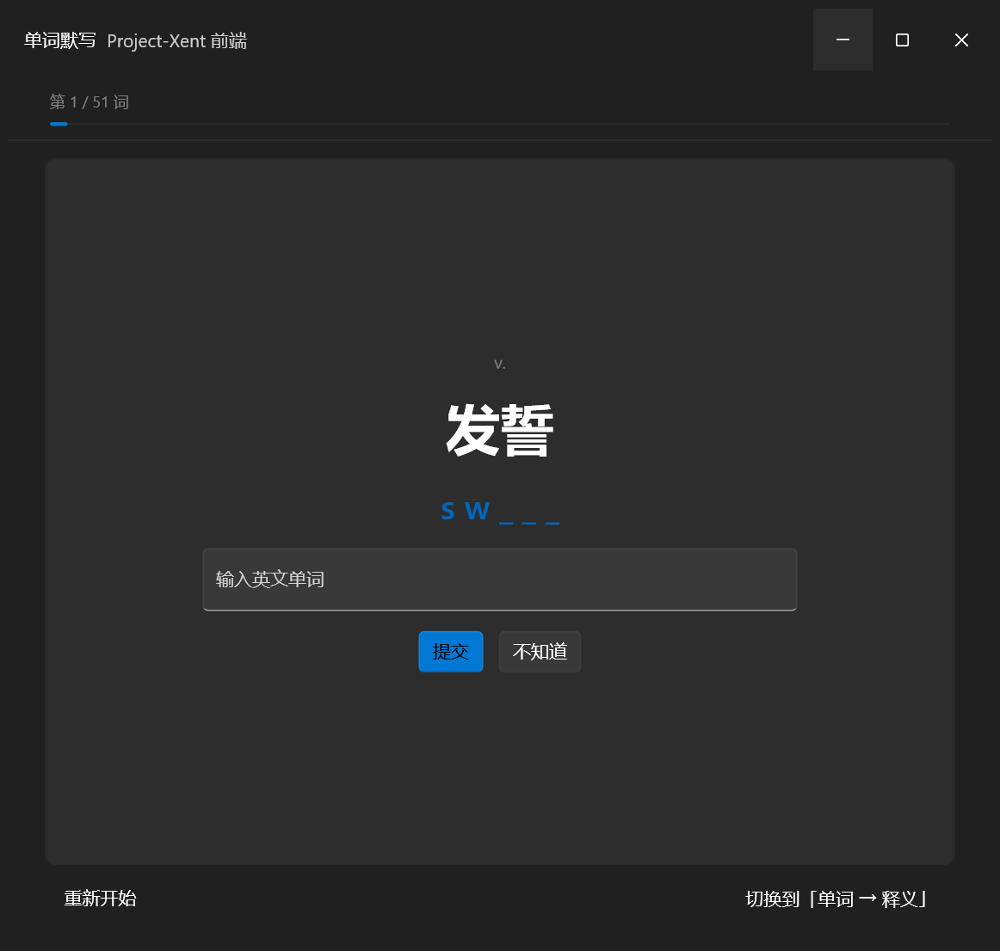

# xent-dictation · 单词默写（Project-Xent / fluxent 前端）

用 [Project-Xent / fluxent](https://github.com/Project-Xent/fluxent)（C23 + xmake 的 Windows 原生声明式 UI 框架）写的一个英语背词程序前端：约 1200 行纯 C，没有 Web 层，没有 Qt/Electron。



## 功能

- **两种模式**：`释义 → 单词`（默认，带首字母提示 `s w _ _ _`）和 `单词 → 释义`（宽松中文判分）
- **轮次**：第 1 轮全部词，错词进下一轮；全对后结束，可查看本轮错词清单
- **判分**：字面判分（毫秒级，汉字比对 + 同义/子串宽松规则）；可选接本地小模型判分（Jev-Style-0.8B 决策模型，走 llama.cpp `llama-server` 的 `/completion`，取 ` yes` / ` no` 两个 token 的 logprob 差换算置信度）——没配就自动只用字面判分，不阻塞做题
- **数据文件**（放程序工作目录）：`dictation_extra.json`（词表 `[["word","pos","meaning"], ...]`）、`dictation_judge.json`（判分配置）

## 构建

前置：

- Windows 11 + Visual Studio 2022（C++ 桌面开发工作负载）
- [xmake](https://xmake.io) 3.x
- 框架源码（dev 布局，四个仓库放同级目录）：
  [fluxent](https://github.com/Project-Xent/fluxent)、[xent-kit](https://github.com/Project-Xent/xent-kit)、
  [xent-core](https://github.com/Project-Xent/xent-core)、[cwinrt](https://github.com/Project-Xent/cwinrt)

步骤：

1. 把本仓库的 `examples/dictation/` 整个目录放进 `fluxent/` 仓库对应位置（与其他 examples 同级）
2. 把 `xmake-targets.lua` 里的两个 target 追加到 `fluxent/xmake.lua` 末尾
3. 构建：

```bat
cd fluxent
xmake build dictation
```

产物在 `fluxent/build/windows/x64/release/dictation.exe`。运行时的工作目录必须是数据文件所在处
（`run-dictation.bat` 是一个示例启动脚本，路径改成你自己的即可）。

## 无头布局自检

```bat
xmake build test_dict_layout
xmake run   test_dict_layout
```

不开窗口，直接把当前视图里**每个节点的实际矩形**打印出来：

```
root         d=0  rect x=    0.0 y=    0.0 w=  760.0 h=  700.0
root.0       d=1  rect x=    0.0 y=    0.0 w=  760.0 h=   48.0   ← 标题栏
root.3       d=1  rect x=    0.0 y=  102.0 w=  760.0 h=  548.0   ← 舞台（撑满）
root.3.0     d=2  rect x=   28.0 y=  116.0 w=  704.0 h=  524.0   ← 卡片
root.3.0.1   d=3  rect x=   64.0 y=  286.7 w=  632.0 h=   53.3   ← 大字题面
```

改版面时比开窗口截屏快得多——本项目的版面就是靠它调出来的（还可以用 `STAGE=<n>` 环境变量
只渲染视图的某个子集来二分定位问题）。

## 踩过的框架坑（供参考）

1. **系统标题栏没被摘掉**：`.integrate_window = true` 在当前框架/系统组合下仍会画出原生标题栏
   （官方 example 也复现），窗口顶部出现两组最小化/最大化/关闭按钮。这里的做法是启动后等窗口
   真正可见，再自己摘掉 `WS_CAPTION`——注意**不能太早**，在窗口显示流程中改样式会让窗口一直不显示。
   框架自己负责的拖动区、按钮命中（`HTCAPTION` / `HTMINBUTTON` / `HTMAXBUTTON`）不受影响。
2. **要撑满的容器得 `fill + grow` 一起用**：`{ .fill = true }` 只影响容器**内部**的主轴分配；
   在父级里占满剩余空间还需要 `xtk_grow(el, 1.0f)`。根节点同理（官方画廊的写法就是
   `xtk_grow(xtk_column(...), 1.0f)`）。
3. **无头测试里必须注册文本测量**：`flux_text_create()` + `flux_text_register(txt, ctx)`。
   不注册的话文本节点的布局高度会退回默认字号，大字全部重叠——看起来像布局 bug，其实是没测量。
4. `xtk_spacer()` 是吃空间的弹性元素，和 `justify = CENTER` 混用会破坏居中。

## 许可

MIT（见 `LICENSE`）。框架本体的版权归 Project-Xent 各仓库所有；本仓库只包含应用层代码。
